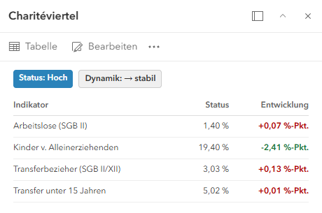
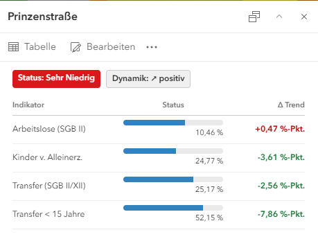
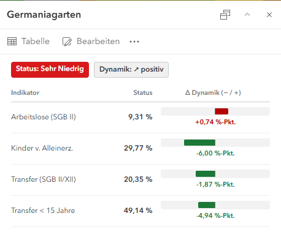
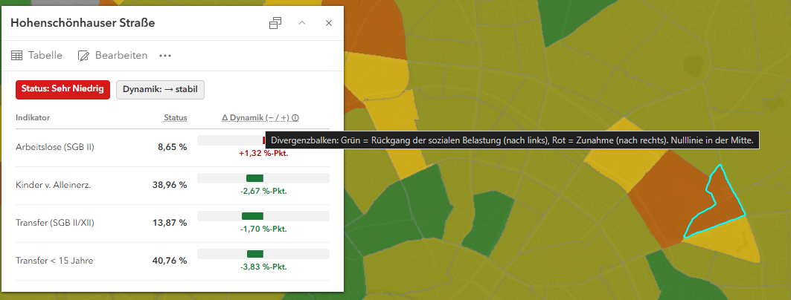

<details>
<summary>Badges & Farben</summary>



Erweiterte Formatierung
```javascript
// 1. Status- und Dynamik-Badges
var  sk = $feature.SK;
var  dk = $feature.DK;

var  bgStatus = When(
	sk == "hoch", "#08ac1bff",
	sk == "mittel", "#abdda4",
	sk == "niedrig", "#fdae61",
	sk == "sehr niedrig", "#d7191c",
	"#cccccc"
);

var  iconDyn = When(
	dk == "positiv", "↗ positiv",
	dk == "negativ", "↘ negativ",
	"→ stabil"
);

var  headerHtml = "<div style='display:flex; gap:8px; margin-bottom:12px; font-size:12px; font-weight:600;'>" +
	"<span style='background:" + bgStatus + "; color:#fff; padding:3px 8px; border-radius:4px;'>Status: " + Proper(sk) + "</span>" +
	"<span style='background:#f0f0f0; color:#333; padding:3px 8px; border-radius:4px; border:1px solid #ccc;'>Dynamik: " + iconDyn + "</span>" +
	"</div>";

// 2. Formatierungsfunktionen
function  formatChange(val) {
	if (IsEmpty(val)) return  "–";
	var  num = Round(val, 2);
	var  sign = IIf(num > 0, "+", "");
	var  col = When(
		num > 0, "#b30000",
		num < 0, "#1b7837",
		"#555555"
	);
	var  formatted = sign + Text(num, "#,##0.00") + " %-Pkt.";
	return  "<span style='color:" + col + "; font-weight:600;'>" + formatted + "</span>";
}

function  formatStatus(val) {
	if (IsEmpty(val)) return  "–";
	return  Text(Round(val, 2), "#,##0.00") + " %";
}

// 3. Tabelle
var  rows = [
	{ label: "Arbeitslose (SGB II)", s: $feature.S1, d: $feature.D1 },
	{ label: "Kinder v. Alleinerziehenden", s: $feature.S2, d: $feature.D2 },
	{ label: "Transferbezieher (SGB II/XII)", s: $feature.S3, d: $feature.D3 },
	{ label: "Transfer unter 15 Jahren", s: $feature.S4, d: $feature.D4 }
];

var  tableHtml = "<table style='width:100%; border-collapse:collapse; font-size:12px;'>" +
				"<tr style='border-bottom:1px solid #ddd; color:#666; text-align:left;'>" +
				"<th style='padding:4px 0;'>Indikator</th>" +
				"<th style='padding:4px; text-align:right;'>Status</th>" +
				"<th style='padding:4px 0; text-align:right;'>Entwicklung</th>" +
				"</tr>";

for (var  i  =  0;  i  <  Count(rows); i++) {
	var  r = rows[i];
	tableHtml += "<tr style='border-bottom:1px solid #eee;'>" +
				"<td style='padding:6px 0;'>" + r.label + "</td>" +
				"<td style='padding:6px 4px; text-align:right;'>" + formatStatus(r.s) + "</td>" +
				"<td style='padding:6px 0; text-align:right;'>" + formatChange(r.d) + "</td>" +
				"</tr>";
}
tableHtml += "</table>";

// 4. Rückgabe als formatierter Inhalt
return {
	type: "text",
	text: headerHtml + tableHtml
};
```
</details>


<details>
<summary>Barcharts</summary>



Erweiterte Formatierung
```javascript
// 1. Status- und Dynamik-Badges
var  sk = $feature.SK;
var  dk = $feature.DK;

var  bgStatus = When(
	sk == "hoch", "#0d8c1cff",
	sk == "mittel", "#abdda4",
	sk == "niedrig", "#fdae61",
	sk == "sehr niedrig", "#d7191c",
	"#cccccc"
);

var  iconDyn = When(
	dk == "positiv", "↗ positiv",
	dk == "negativ", "↘ negativ",
	"→ stabil"
);

var  headerHtml = "<div style='display:flex; gap:8px; margin-bottom:12px; font-size:12px; font-weight:600;'>" +
				"<span style='background:" + bgStatus + "; color:#fff; padding:3px 8px; border-radius:4px;'>Status: " + Proper(sk) + "</span>" +
				"<span style='background:#f0f0f0; color:#333; padding:3px 8px; border-radius:4px; border:1px solid #ccc;'>Dynamik: " + iconDyn + "</span>" +
				"</div>";
  
// 2. Hilfsfunktion für die Zeilen (Balken ohne Kommafehler im CSS)
function  renderMetricRow(label, sVal, maxVal, dVal) {
	if (IsEmpty(sVal)) return  "";

	// Ganzzahlig gerundeter Prozentsatz verhindert das CSS-Kommaproblem
	var  pct = Text(Round(Min((sVal / maxVal) * 100, 100), 0), "#0");
	var  sFormatted = Text(Round(sVal, 2), "#,##0.00") + " %";
	
	// Vorzeichen und Farbkodierung der Dynamik
	var  dFormatted = "–";
	var  dCol = "#555555";
	if (!IsEmpty(dVal)) {
		var  dNum = Round(dVal, 2);
		var  sign = IIf(dNum > 0, "+", "");
		dCol = When(dNum > 0, "#b30000", dNum < 0, "#1b7837", "#555555");
		dFormatted = sign + Text(dNum, "#,##0.00") + " %-Pkt.";
	}

	return  "<tr style='border-bottom:1px solid #eee;'>" +
			"<td style='padding:6px 0; width:36%; font-size:12px;'>" + label + "</td>" +
			"<td style='padding:6px 8px; width:38%;'>" +
				"<div style='background:#eaeaea; height:8px; border-radius:4px; overflow:hidden; margin-bottom:2px;'>" +
					"<div style='background:#3182bd; width:" + pct + "%; height:100%;'></div>" +
				"</div>" +
				"<div style='font-size:11px; color:#444; text-align:right;'>" + sFormatted + "</div>" +
			"</td>" +
			"<td style='padding:6px 0; width:26%; text-align:right; font-size:12px; font-weight:600; 			color:" + dCol + ";'>" +
				dFormatted +
			"</td>" +
			"</tr>";
}
 
// 3. Tabellengerüst mit Referenz-Maximalwerten für Berlin
var  tableHtml = "<table style='width:100%; border-collapse:collapse;'>" +
				"<tr style='border-bottom:1px solid #ccc; font-size:11px; color:#777; text-align:left;'>" +
				"<th style='padding:4px 0;'>Indikator</th>" +
				"<th style='padding:4px 8px; text-align:center;'>Status</th>" +
				"<th style='padding:4px 0; text-align:right;'>Δ Trend</th>" +
				"</tr>" +
				renderMetricRow("Arbeitslose (SGB II)", $feature.S1, 17.0, $feature.D1) +
				renderMetricRow("Kinder v. Alleinerz.", $feature.S2, 47.0, $feature.D2) +
				renderMetricRow("Transfer (SGB II/XII)", $feature.S3, 36.0, $feature.D3) +
				renderMetricRow("Transfer < 15 Jahre", $feature.S4, 65.0, $feature.D4) +
				"</table>";
 
// 4. Strukturierte Rückgabe für das Arcade-Inhaltselement
return {
	type: "text",
	text: headerHtml + tableHtml
};
```
</details>

<details>
<summary>Barcharts pos/neg</summary>



Erweiterte Formatierung
```javascript
// 1. Status- und Dynamik-Badges
var  sk = $feature.SK;
var  dk = $feature.DK;
 
var  bgStatus = When(
	sk == "hoch", "#0d8c1cff",
	sk == "mittel", "#abdda4",
	sk == "niedrig", "#fdae61",
	sk == "sehr niedrig", "#d7191c",
	"#cccccc"
);
  
var  iconDyn = When(
	dk == "positiv", "↗ positiv",
	dk == "negativ", "↘ negativ",
	"→ stabil"
);
  
var  headerHtml = "<div style='display:flex; gap:8px; margin-bottom:12px; font-size:12px; font-weight:600;'>" +
				"<span style='background:" + bgStatus + "; color:#fff; padding:3px 8px; border-radius:4px;'>Status: " + Proper(sk) + "</span>" +
				"<span style='background:#f0f0f0; color:#333; padding:3px 8px; border-radius:4px; border:1px solid #ccc;'>Dynamik: " + iconDyn + "</span>" +
				"</div>";

// 2. Robuster Flexbox-Divergenzbalken (funktioniert ohne 'position: absolute')
function  renderDivergingBar(val, maxRange) {
	if (IsEmpty(val)) {
		return  "<div style='color:#999; font-size:11px; text-align:center;'>–</div>";
	}
  
	var  num = Round(val, 2);
	var  clamped = Max(Min(num, maxRange), -maxRange);
  
	// Breite in Prozent der jeweiligen 50%-Hälfte (max. 95%)
	var  barWidth = Text(Round((Abs(clamped) / maxRange) * 95, 0), "#0");
  
	// Farbsemantik MSS: Sinken = grün (#1b7837), Steigen = rot (#b30000), 0 = grau
	var  col = When(
		num > 0, "#b30000",
		num < 0, "#1b7837",
		"#666666"
	);
  
	var  sign = IIf(num > 0, "+", "");
	var  formattedText = sign + Text(num, "#,##0.00") + " %-Pkt.";
  
	// Linker Balken (wächst nach links) vs. rechter Balken (wächst nach rechts)
	var  leftBar = "";
	var  rightBar = "";
  
	if (num < 0) {
		leftBar = "<div style='width:" + barWidth + "%; height:10px; background:" + col + "; border-radius:2px 0 0 2px;'></div>";
	} else  if (num > 0) {
		rightBar = "<div style='width:" + barWidth + "%; height:10px; background:" + col + "; border-radius:0 2px 2px 0;'></div>";
	}

	var  barHtml = "<div style='display:flex; width:100%; height:14px; background:#f2f2f2; border-radius:3px; padding:2px 0; box-sizing:border-box;'>" +
					// Linke Hälfte (50%): Ausrichtung nach rechts (flex-end) stößt an die Mittellinie
					"<div style='width:50%; height:100%; display:flex; justify-content:flex-end; border-right:1px solid #777; box-sizing:border-box;'>" +
					leftBar +
				"</div>" +
					// Rechte Hälfte (50%): Ausrichtung nach links (flex-start) startet an der Mittellinie
					"<div style='width:50%; height:100%; display:flex; justify-content:flex-start; box-sizing:border-box;'>" +
					rightBar +
					"</div>" +
					"</div>" +
					"<div style='font-size:11px; font-weight:600; text-align:center; color:" + col + "; margin-top:2px;'>" +
						formattedText +
					"</div>";
 
	return  barHtml;
}
  
// 3. Zeilenaufbau für die Tabelle
function  renderRow(label, sVal, dVal, maxRange) {
	if (IsEmpty(sVal)) return  "";
	var  sFormatted = Text(Round(sVal, 2), "#,##0.00") + " %";

	return  "<tr style='border-bottom:1px solid #eee;'>" +
			"<td style='padding:8px 0; width:34%; font-size:12px; vertical-align:middle;'>" + label + "</td>" +
			"<td style='padding:8px 6px; width:22%; font-size:12px; font-weight:600; text-align:right; vertical-align:middle; color:#333;'>" +
				sFormatted +
			"</td>" +
			"<td style='padding:8px 0 8px 8px; width:44%; vertical-align:middle;'>" +
				renderDivergingBar(dVal, maxRange) +
			"</td>" +
			"</tr>";
}

// 4. Tabellengerüst mit kalibrierten Skalenbereichen (maxRange) für D1-D4
var  tableHtml = "<table style='width:100%; border-collapse:collapse;'>" +
				"<tr style='border-bottom:1px solid #ccc; font-size:11px; color:#777; text-align:left;'>" +
				"<th style='padding:4px 0;'>Indikator</th>" +
				"<th style='padding:4px 6px; text-align:right;'>Status</th>" +
				"<th style='padding:4px 0; text-align:center;'>Δ Dynamik (− / +)</th>" +
				"</tr>" +
				renderRow("Arbeitslose (SGB II)", $feature.S1, $feature.D1, 3.0) +
				renderRow("Kinder v. Alleinerz.", $feature.S2, $feature.D2, 10.0) +
				renderRow("Transfer (SGB II/XII)", $feature.S3, $feature.D3, 5.0) +
				renderRow("Transfer < 15 Jahre", $feature.S4, $feature.D4, 15.0) +
				"</table>";
  
// 5. Strukturierte Rückgabe für Arcade-Inhaltselement
return {
	type: "text",
	text: headerHtml + tableHtml
};
```
</details>

<details>
<summary>Barcharts mit Tooltip</summary>



Erweiterte Formatierung
```javascript
// 1. Status- und Dynamik-Badges
var  sk = $feature.SK;
var  dk = $feature.DK;
 
var  bgStatus = When(
	sk == "hoch", "#0d8c1cff",
	sk == "mittel", "#abdda4",
	sk == "niedrig", "#fdae61",
	sk == "sehr niedrig", "#d7191c",
	"#cccccc"
);
  
var  iconDyn = When(
	dk == "positiv", "↗ positiv",
	dk == "negativ", "↘ negativ",
	"→ stabil"
);
  
var  headerHtml = "<div style='display:flex; gap:8px; margin-bottom:12px; font-size:12px; font-weight:600;'>" +
				"<span style='background:" + bgStatus + "; color:#fff; padding:3px 8px; border-radius:4px;'>Status: " + Proper(sk) + "</span>" +
				"<span style='background:#f0f0f0; color:#333; padding:3px 8px; border-radius:4px; border:1px solid #ccc;'>Dynamik: " + iconDyn + "</span>" +
				"</div>";
 
// 2. Hilfsfunktion: Flexbox-Divergenzbalken mit Tooltip (title-Attribut)
function  renderDivergingBar(val, maxRange, label) {
	if (IsEmpty(val)) {
			return  "<div style='color:#999; font-size:11px; text-align:center;'>–</div>";
}
  
	var  num = Round(val, 2);
	var  clamped = Max(Min(num, maxRange), -maxRange);
  
	// Breite in Prozent der jeweiligen 50%-Hälfte (max. 95%)
	var  barWidth = Text(Round((Abs(clamped) / maxRange) * 95, 0), "#0");
	  
	// Farbsemantik MSS: Sinken = grün (#1b7837), Steigen = rot (#b30000), 0 = grau
	var  col = When(
		num > 0, "#b30000",
		num < 0, "#1b7837",
		"#666666"
	);

	var  sign = IIf(num > 0, "+", "");
	var  formattedText = sign + Text(num, "#,##0.00") + " %-Pkt.";
  
	// Tooltip-Text für den Balken
	var  directionText = When(
		num > 0, "Verschlechterung / Zunahme",
		num < 0, "Verbesserung / Rückgang",
		"Keine Veränderung"
	);
	var  tipText = label + ": " + formattedText + " (" + directionText + "). Skala bis ±" + maxRange + " %-Pkt.";
  
// Balken links oder rechts
	var  leftBar = "";
	var  rightBar = "";
  
	if (num < 0) {
		leftBar = "<div style='width:" + barWidth + "%; height:10px; background:" + col + "; border-radius:2px 0 0 2px;'></div>";
	} else  if (num > 0) {
		rightBar = "<div style='width:" + barWidth + "%; height:10px; background:" + col + "; border-radius:0 2px 2px 0;'></div>";
	}
  
var  barHtml = "<div title='" + tipText + "' style='cursor:help;'>" +
					"<div style='display:flex; width:100%; height:14px; background:#f2f2f2; border-radius:3px; padding:2px 0; box-sizing:border-box;'>" +
						// Linke Hälfte (grün)
						"<div style='width:50%; height:100%; display:flex; justify-content:flex-end; border-right:1px solid #777; box-sizing:border-box;'>" +
						leftBar +
						"</div>" +
						// Rechte Hälfte (rot)
						"<div style='width:50%; height:100%; display:flex; justify-content:flex-start; box-sizing:border-box;'>" +
							rightBar +
						"</div>" +
					"</div>" +
					"<div style='font-size:11px; font-weight:600; text-align:center; color:" + col + "; margin-top:2px;'>" +
						formattedText +
					"</div>" +
					"</div>";
  
	return  barHtml;
}
  
// 3. Zeilenaufbau mit zusätzlichem Status-Tooltip (z. B. Berliner Mittelwert als Referenz)
function  renderRow(label, sVal, dVal, maxRange, berlinAvg) {
	if (IsEmpty(sVal)) return  "";
	var  sFormatted = Text(Round(sVal, 2), "#,##0.00") + " %";
	var  statusTip = label + " im Quartier: " + sFormatted + " (Berliner Schnitt: " + berlinAvg + " %)";
  
	return  "<tr style='border-bottom:1px solid #eee;'>" +
			"<td style='padding:8px 0; width:34%; font-size:12px; vertical-align:middle;'>" + label + "</td>" +
			"<td title='" + statusTip + "' style='cursor:help; padding:8px 6px; width:22%; font-size:12px; font-weight:600; text-align:right; vertical-align:middle; color:#333;'>" +
				sFormatted +
			"</td>" +
			"<td style='padding:8px 0 8px 8px; width:44%; vertical-align:middle;'>" +
					renderDivergingBar(dVal, maxRange, label) +
				"</td>" +
				"</tr>";
}

// 4. Tabellenkopf mit erklärenden Tooltips (gestrichelte Unterstreichung signalisiert Interaktivität)
var  headerTipDyn = "Divergenzbalken: Grün = Rückgang der sozialen Belastung (nach links), Rot = Zunahme (nach rechts). Nulllinie in der Mitte.";
var  headerTipStatus = "Aktueller Anteil der betroffenen Personengruppe.";
 
var  tableHtml = "<table style='width:100%; border-collapse:collapse;'>" +
				"<tr style='border-bottom:1px solid #ccc; font-size:11px; color:#777; text-align:left;'>" +
				"<th style='padding:4px 0;'>Indikator</th>" +
				"<th title='" + headerTipStatus + "' style='cursor:help; padding:4px 6px; text-align:right; text-decoration:underline dotted;'>Status</th>" +
				"<th title='" + headerTipDyn + "' style='cursor:help; padding:4px 0; text-align:center; text-decoration:underline dotted;'>Δ Dynamik (− / +) ⓘ</th>" +
				"</tr>" +
				renderRow("Arbeitslose (SGB II)", $feature.S1, $feature.D1, 3.0, "4,69") +
				renderRow("Kinder v. Alleinerz.", $feature.S2, $feature.D2, 10.0, "24,00") +
				renderRow("Transfer (SGB II/XII)", $feature.S3, $feature.D3, 5.0, "9,87") +
				renderRow("Transfer < 15 Jahre", $feature.S4, $feature.D4, 15.0, "20,75") +
				"</table>";
  
// 5. Strukturierte Rückgabe für Arcade-Inhaltselement
return {
	type: "text",
	text: headerHtml + tableHtml
};
```
</details>


